# BITE

**AA smart fitness coach, designed and built by one developer over approximately 9 months.**

BITE brings training, nutrition, recovery, progress and coaching into one experience. Members can plan and log workouts, track meals and see how their activity develops over time. The coach uses that context to offer practical, personalized guidance.

I have built the mobile app, Apple Watch companion, backend, internal admin console and marketing site, from product decisions through implementation and release.

<a href="https://www.bitefitness.app/features">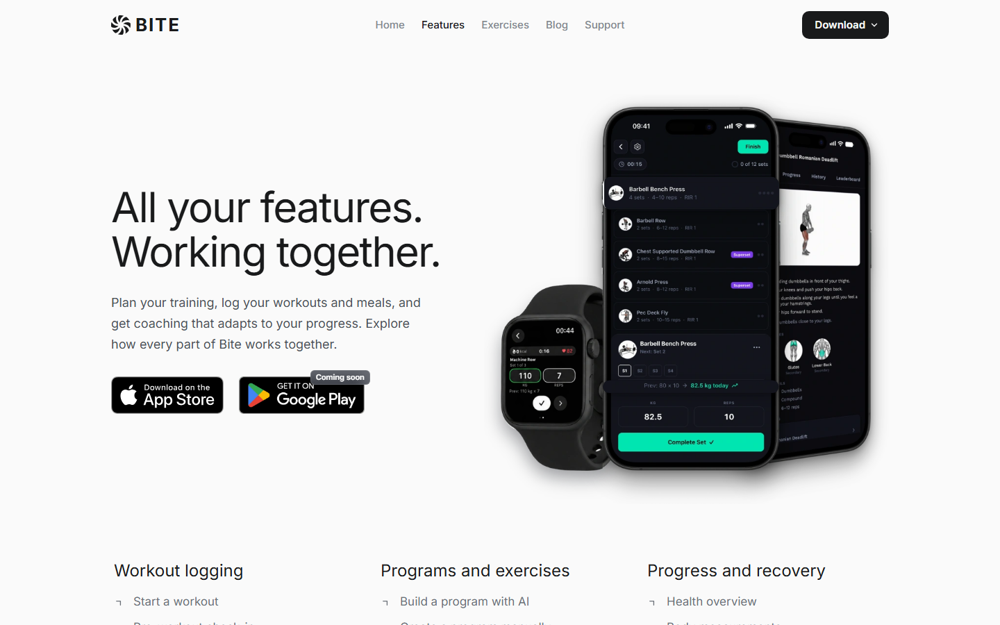</a>

 

## What I built

| Surface | What it does |
| --- | --- |
| **Mobile app** | Plans and logs workouts; tracks food, recovery and progress; brings coaching, goals and community features together. |
| **Apple Watch** | Starts and follows workouts, logs sets and shows workout information from the wrist. |
| **Backend** | A Spring Boot API coordinates product logic, data, integrations and background work. |
| **Admin console** | A separate Next.js app manages users, waitlist, reports, programs, achievements and jobs. |
| **Marketing site** | A Next.js site with interactive product demos, feature guides, exercise pages and a blog. |

The private backend contains **50+ API controllers** and **200+ versioned database migrations**, rounded from the source tree on 21 October 2026. These describe scope; they are not performance or usage claims. The visual maps below show selected relationships without exposing the production schema or route inventory.

## Inside the app

Four phone views cover an active workout, the social feed, nutrition and program discovery. Two captured Apple Watch screens show set logging and the rest timer. All features can be viewed on BITE's marketing website or in the app.

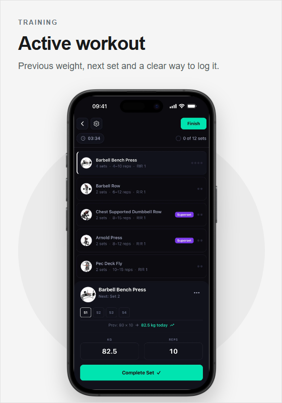 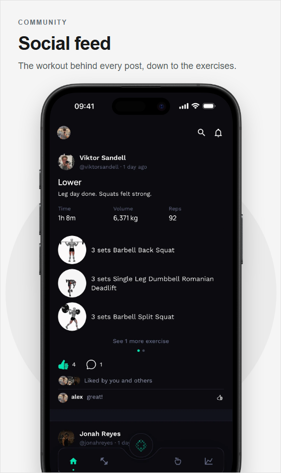

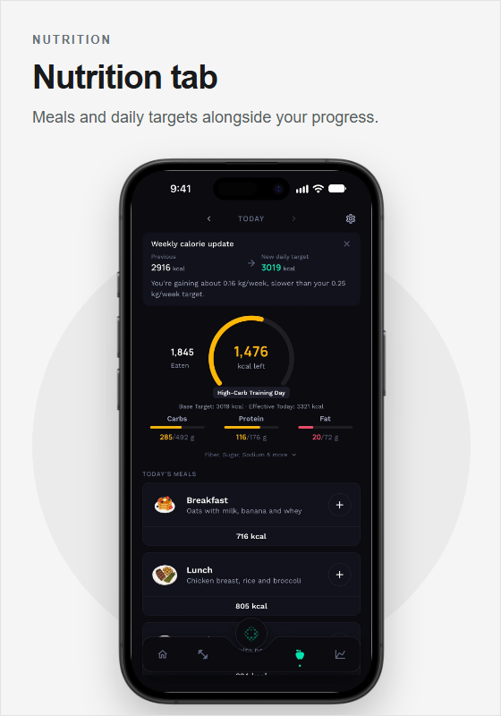 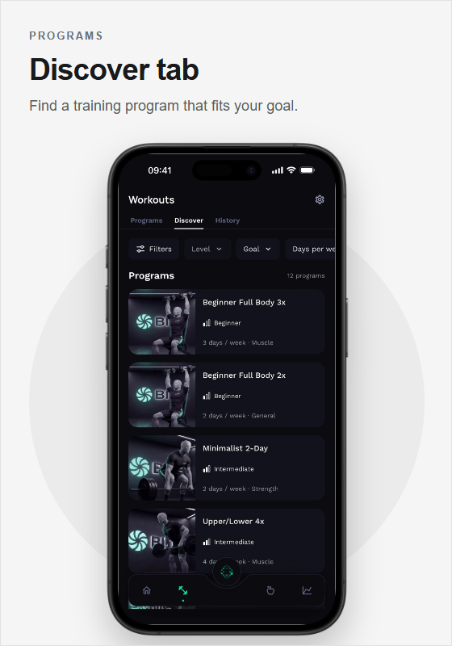

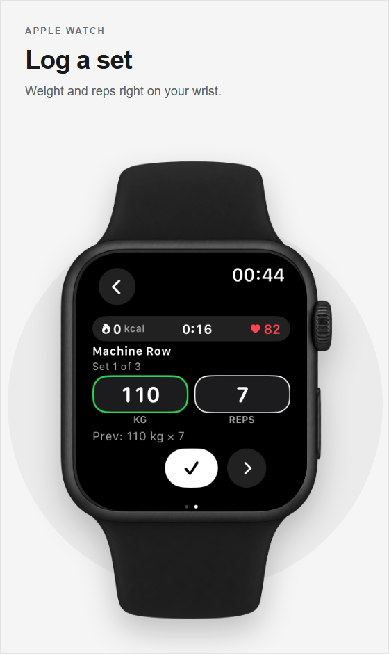 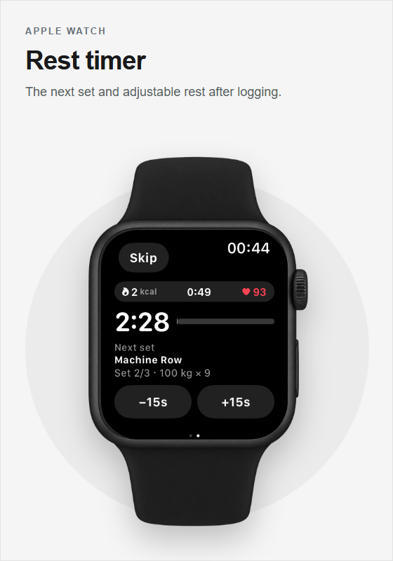

The rest of the product includes onboarding, goals, program import, exercise discovery, nutrition, recovery, achievements, subscriptions, notifications and support flows. Explore the [feature guides](https://www.bitefitness.app/features) or the [App Store listing](https://apps.apple.com/app/id6770621331) for more screens.

## The site is part of the product

The marketing site explains the product through working interactions. Its desktop feature section moves through a spiral of app screens as the copy changes.

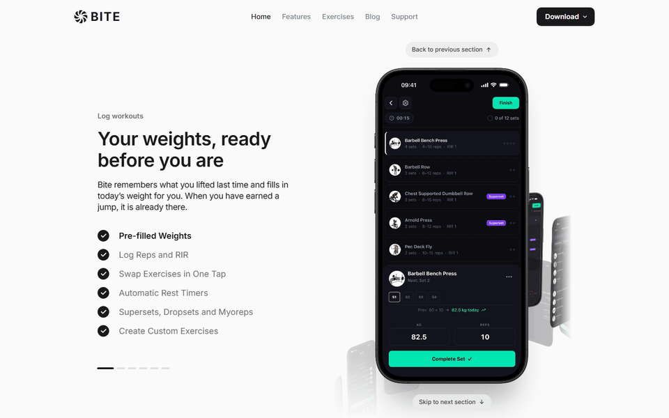

The home page opens with a scripted BITE Coach conversation. It demonstrates a coaching suggestion based on training context.

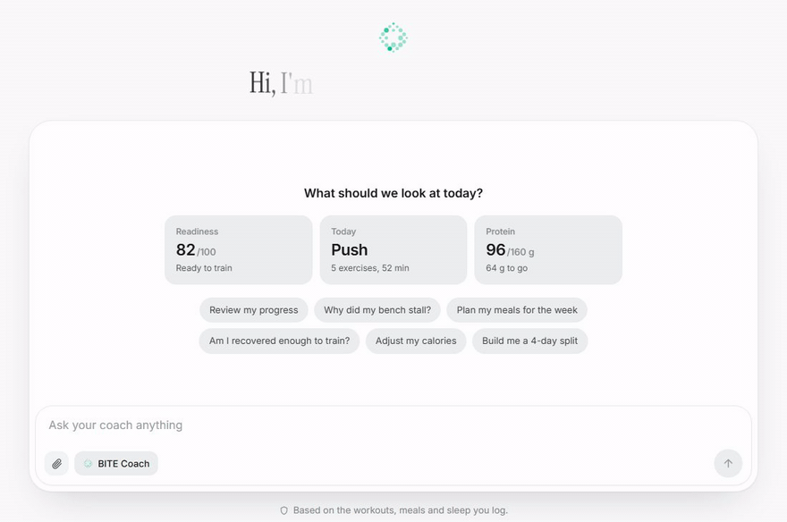

The site also contains feature guides, an exercise library and a CMS driven blog.

## Behind the app: the admin console

The internal admin app gives me one place to manage and inspect the product: activity, users, user reports, waitlist, reports, discoverable programs, achievements and background jobs. The screenshot uses **synthetic example data** and shows the interface only.

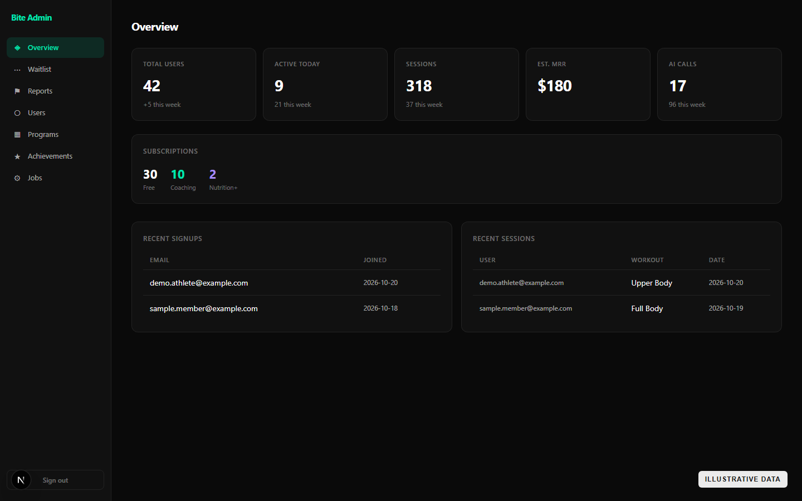

## How the system fits together

The mobile app uses React Native and Expo. The Apple Watch companion extends workout logging. A modular Spring Boot API coordinates product logic and stores durable data in Supabase Postgres. Exercise media and other images use Supabase Storage. The backend owns the coaching decisions and business rules. OpenAI helps interpret user input and phrase the responses in natural language. Oura, Apple watch and WHOOP bring wearable data into recovery. A separate Next.js admin console supports operations, while the Next.js marketing site reads editorial content from Sanity.

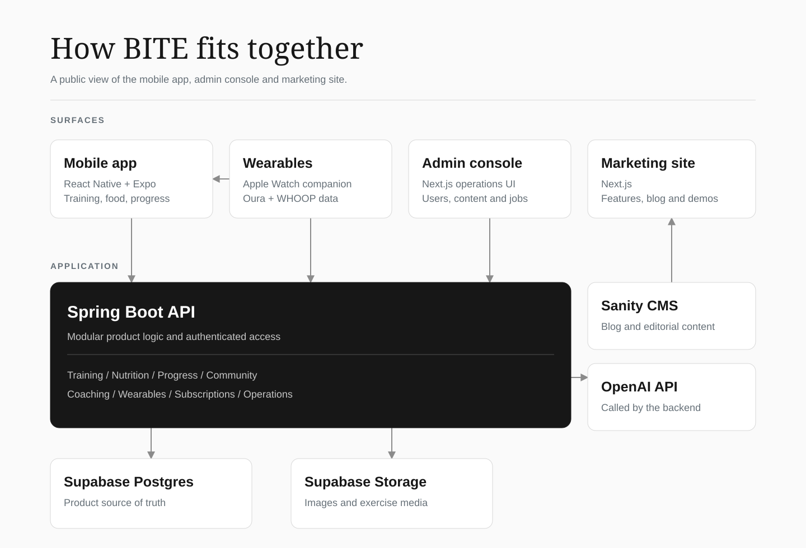

Three choices shaped the implementation:

- **One source of product data.** Workouts, food logs and progress flow through the API so the mobile and companion experiences stay consistent.
- **Backend owned AI integration.** The app requests coaching through the API, which handles product context and provider calls.
- **Separate public and operational interfaces.** The admin console runs the product; the marketing site explains it.

### From plan to progress

A member organises exercises into a program, performs a session and records sets. Those records support progress views. Nutrition belongs to the same member experience. This diagram illustrates the main training flow in two rows.

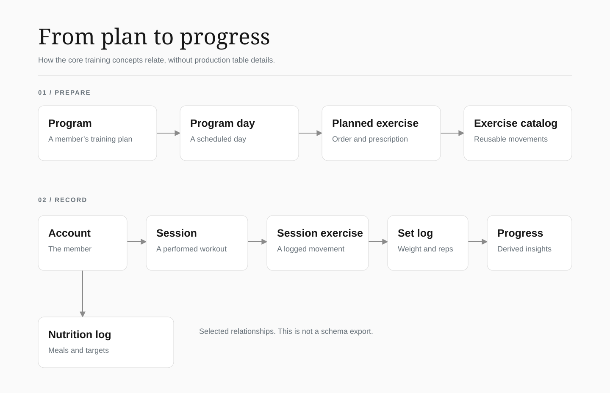

## My role and what is public

I designed the product and made the architectural decisions that shape how BITE works end to end. As a solo developer, my work has spanned the mobile app, backend, data model, integrations, admin tools, marketing site and releases.
The application repositories remain private. This case study uses public product imagery, synthetic admin data and conceptual diagrams. It includes no application source code, credentials, production configuration, real member data, route list or production database schema.
