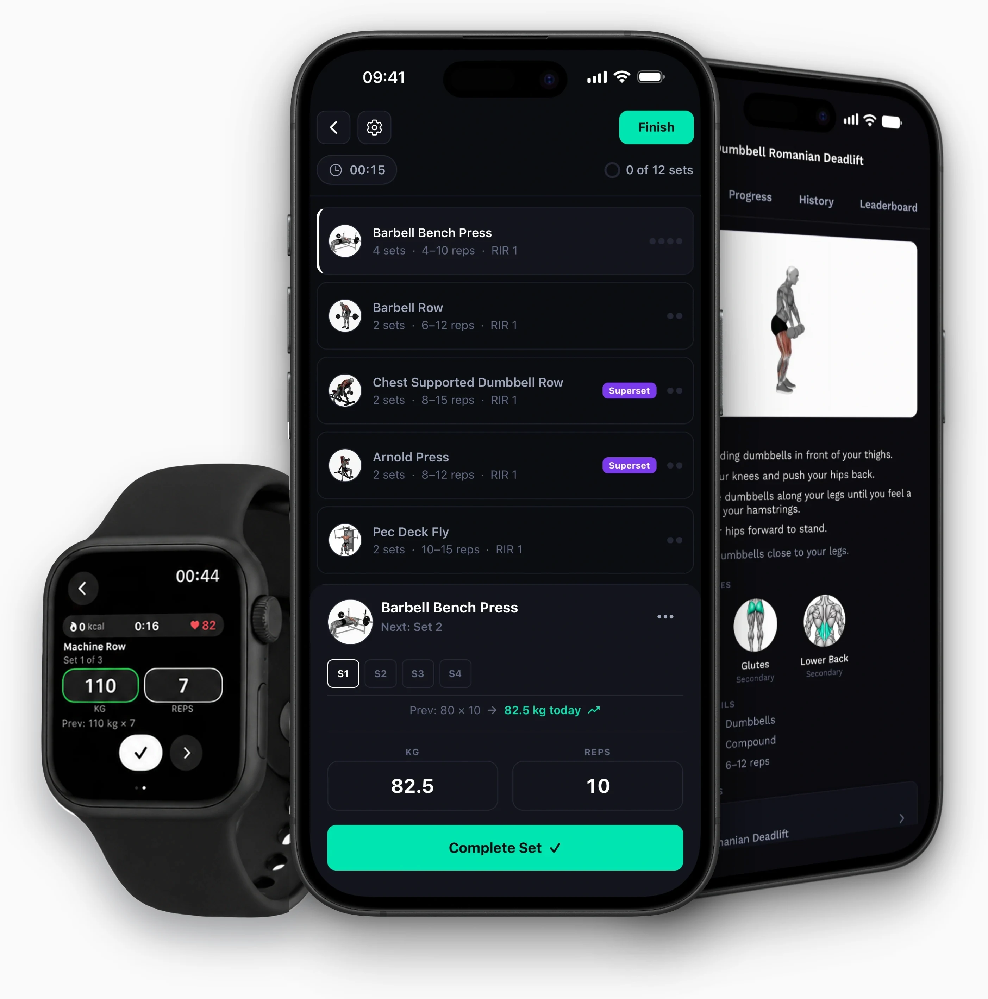
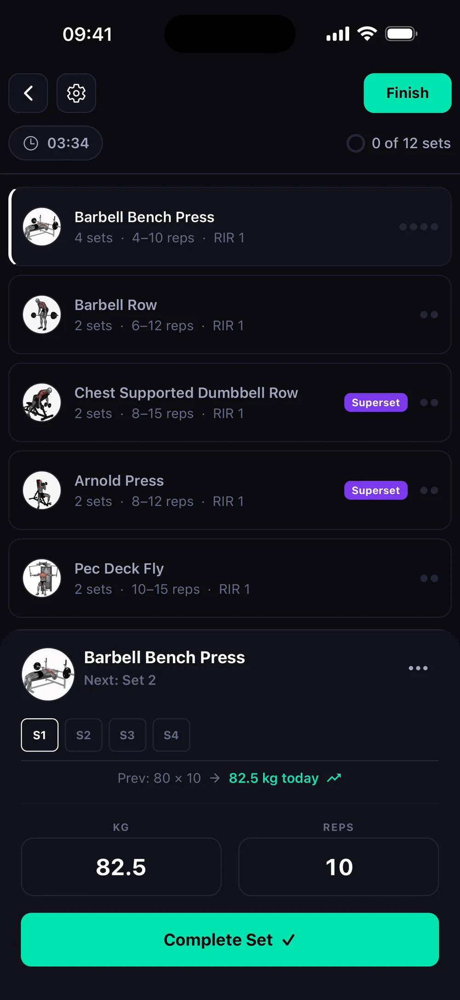
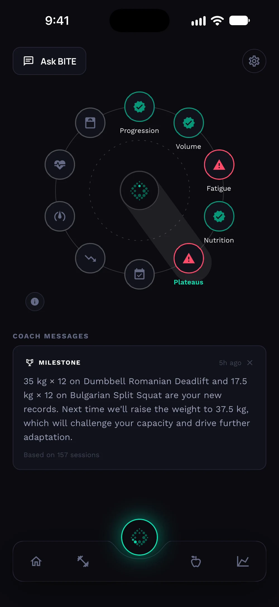
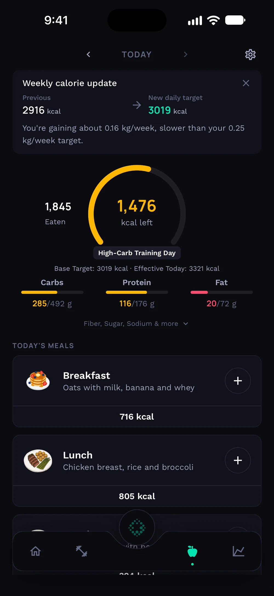
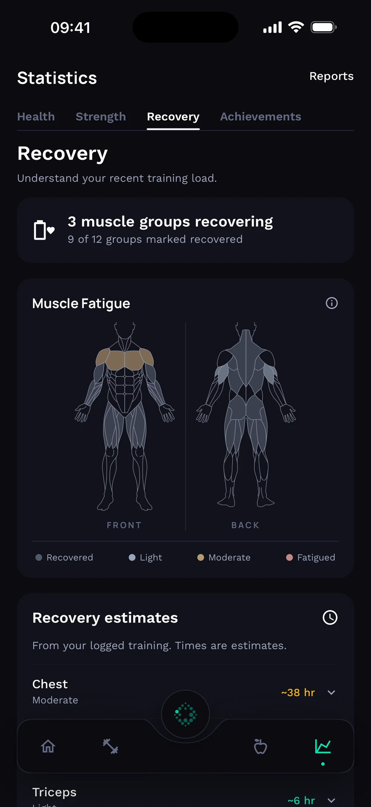
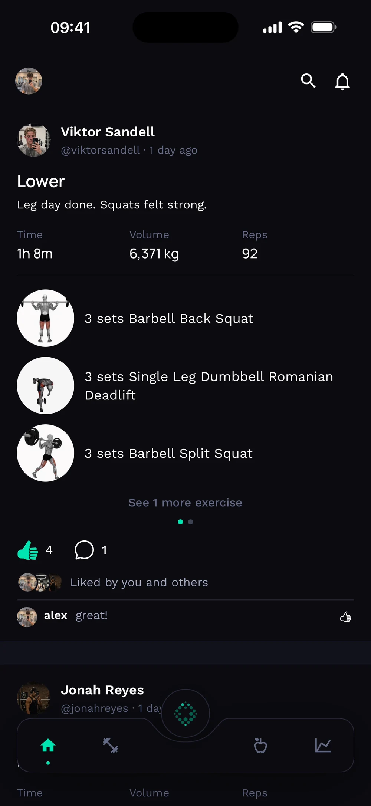
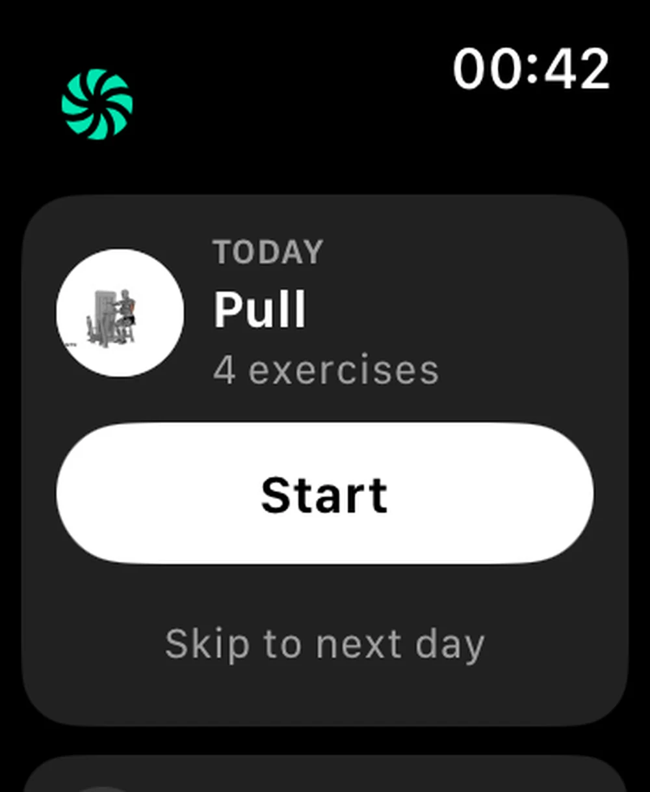
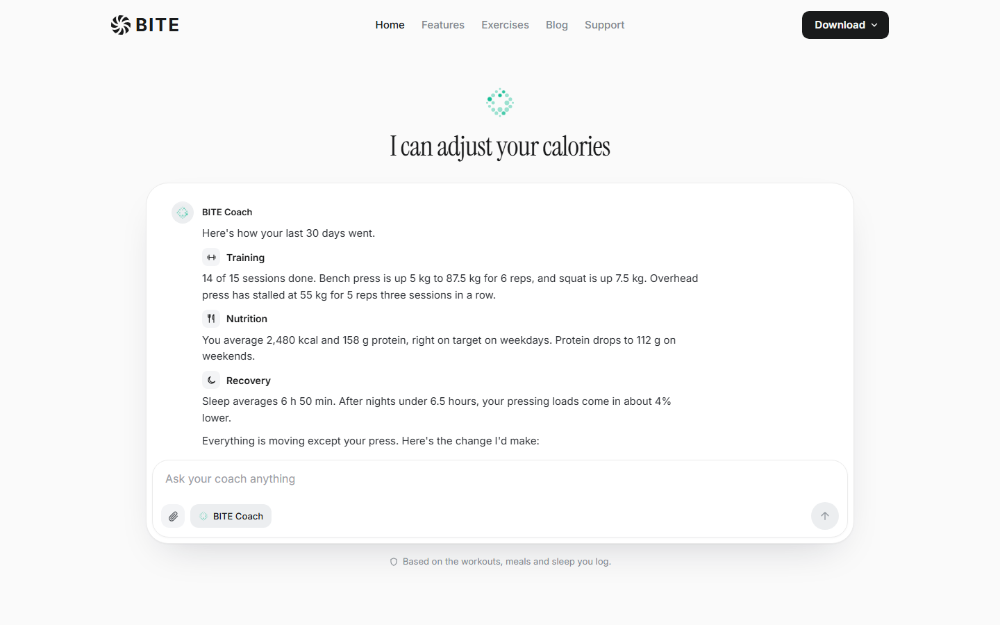
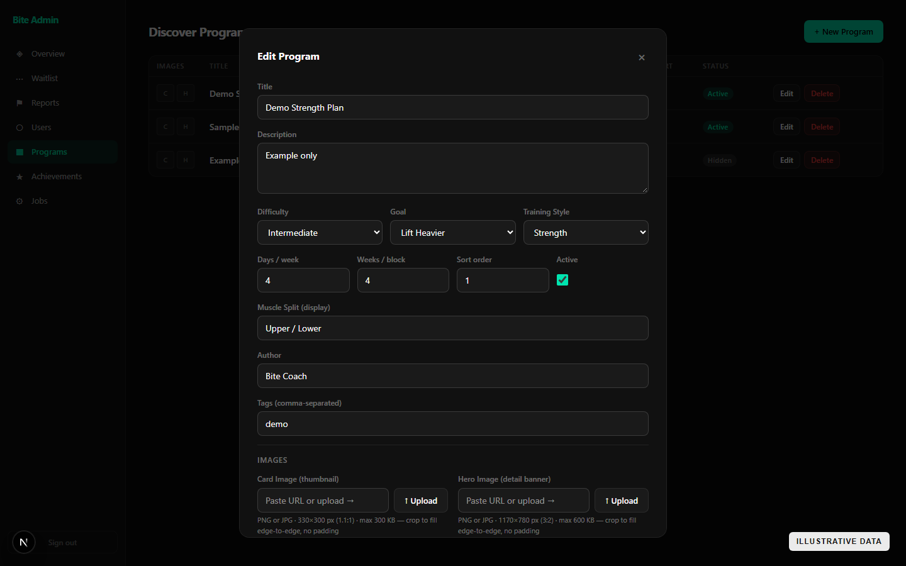

# BITE

**A fitness product I have designed and built as a solo developer over approximately 8–9 months.**

BITE brings training, nutrition, recovery, progress and coaching into one experience. The work spans a mobile app, an Apple Watch companion, a backend, an internal admin console and a marketing site. I own the product decisions and implementation across these surfaces, using Codex and Claude as development tools where useful.

**[Explore the website](https://www.bitefitness.app/)** · **[View BITE on the App Store](https://apps.apple.com/app/id6770621331)**

## What I built

| Surface | Scope |
| --- | --- |
| Mobile app | Plan and log workouts; track food, recovery and progress; use coaching, goals and community features. |
| Apple Watch | Start and follow workouts, log sets and see workout information from the wrist. |
| Backend | A Spring Boot API for product logic, data, integrations and background work. |
| Admin console | A separate Next.js app for users, waitlist, reports, programs, achievements and jobs. |
| Marketing site | A Next.js site with interactive product demos, feature guides, exercise pages and a blog. |

The private backend currently contains **50+ API controllers** and **200+ versioned database migrations**. These are rounded counts from the source tree on 21 October 2026, not user or performance metrics. The diagrams below show the main relationships, not the production schema or a route inventory.

### Inside the app

| Training and programs | BITE Coach |
| --- | --- |
|  |  |
| **Nutrition** | **Progress and recovery** |
|  |  |
| **Community** | **Apple Watch** |
|  |  |

These are illustrative screens already used on the public marketing site.

The private codebase also covers onboarding, goals, program import, exercise discovery, achievements, subscriptions, notifications, social features and support flows. The six screens above are a sample of the product, not a complete feature list.

## The site is part of the product

I built the marketing site to show how BITE works. Its desktop feature section moves through a spiral of product screens while the accompanying copy changes. On mobile, visitors use the arrows to explore the screens.

[Watch the desktop spiral as a video](assets/spiral-desktop.mp4) · [See the mobile interaction](assets/spiral-demo.mp4)

The home page opens with a scripted BITE Coach conversation. It demonstrates a coaching suggestion based on training context; it is not a recording of a real member's chat.

[Watch the coach interaction](assets/coach-demo.mp4)

The feature page also brings the two phone screens and Apple Watch together in its hero. Beyond the demos, the site contains feature guides, an exercise library and a CMS-driven blog.

## Behind the app: the admin console

The internal admin app gives me one place to manage and inspect the product. It includes an overview of activity, user and waitlist management, incoming reports, discoverable training programs, achievements and background jobs. The program editor supports the content and metadata shown in the app.

**Every account, value and program in these admin screenshots is synthetic example data.** The screenshots show the interface only.

## How the system fits together

The mobile app uses React Native and Expo. The Apple Watch companion extends workout logging. A modular Spring Boot API coordinates product logic and stores durable data in Supabase Postgres. Exercise media and other images use Supabase Storage. The backend calls OpenAI for coaching features. Oura and WHOOP connections bring wearable data into the recovery experience. A separate Next.js admin console supports operations, while the Next.js marketing site reads editorial content from Sanity.

Three decisions shaped the implementation:

- **One source of product data.** Workouts, food logs and progress are represented through the API so the mobile and companion experiences can stay consistent.
- **Backend-owned AI integration.** The app requests coaching through the API; provider calls and product context are handled on the server.
- **Separate operational and public interfaces.** The admin console is built for running the product; the marketing site is built for explaining it.

### From plan to progress

A member can organise exercises into a program, perform a session and record sets. Those records support progress views. Nutrition belongs to the same member experience. This diagram selects a few relationships to explain the product flow; it is not a database export.

## My role and what is public

I have worked across product design, mobile engineering, backend architecture, data modelling, integrations, admin tooling, marketing and release work. I use AI coding tools as part of my workflow and review and integrate their output myself.

The application repositories remain private. This case study contains public product imagery, synthetic admin data and conceptual diagrams. It contains no application source, credentials, production configuration, real member data, route list or production database schema.

The watch photo in the hero composition is credited on the BITE site to muhammad.abdullah on Magnific.
